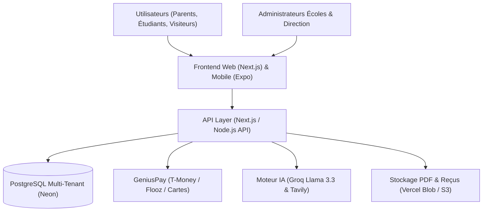

# CampusHub TG (ex-DefiTech Student Hub)

> **Plateforme SaaS B2B2C Multi-Universités & Portail Scolaire Éducatif au Togo.**  
> *Connecter les universités, rassurer les parents, propulser les étudiants.*

---

## 🎯 Vision du Produit

**CampusHub** transforme la gestion et la vie universitaire en Afrique de l'Ouest à travers une plateforme tout-en-un connectant 3 acteurs :

1. **Les Universités & Grandes Écoles (B2B SaaS) :**
   - Chaque établissement dispose de son propre mini-site vitrine et portail de gestion intégré (filières, accréditations, plannings, informations officielles).
   - Modèle d'abonnement basé sur l'effectif étudiant.
   - Dématérialisation complète de l'encaissement des frais de scolarité.

2. **Les Parents d'Élèves (B2C FinTech) :**
   - Consultation directe des emplois du temps et de l'assiduité de leurs enfants.
   - **Paiement en ligne sécurisé des tranches de scolarité** par **Mobile Money (T-Money, Moov Flooz)** ou Carte Bancaire.
   - Fini les files d'attente interminables aux agences bancaires ou à la comptabilité de l'école. Reçu PDF certifié instantané avec QR Code de vérification.

3. **Les Étudiants (B2C EdTech Freemium) :**
   - Compte gratuit rattaché à leur université pour accéder aux cours, emplois du temps et forums de filière.
   - Options payantes d'accélération académique : **Tuteur IA 24/7**, annales corrigées, génération automatique de quiz et simulateur d'examens.

---

## 💰 Modèle Économique & Bénéfices Financiers (Projections Lomé / Togo)

CampusHub s'appuie sur un modèle de revenus à triple moteur :

### 1. Abonnements B2B Écoles (Revenu Récurrent Mensuel - MRR)
Les universités paient une licence d'exploitation indexée sur leur effectif étudiant :
- **Pack Starter (< 300 étudiants) :** 80 000 FCFA / mois (~960 000 FCFA / an).
- **Pack Pro (300 à 1 000 étudiants) :** 200 000 FCFA / mois (~2 400 000 FCFA / an).
- **Pack Enterprise (> 1 000 étudiants) :** 400 000 FCFA / mois (~4 800 000 FCFA / an).
> **Potentiel An 1 (5 écoles signées) :** **~14 400 000 FCFA / an** de chiffre d'affaires récurrent.

### 2. Commissions sur le Paiement des Frais de Scolarité (Volume FinTech)
- Panier moyen de scolarité annuelle par étudiant à Lomé : **500 000 FCFA**.
- Frais de service plateforme : **1% à 1,5%** (facturés comme frais de commodité ou partagés avec l'établissement).
> **Simulation pour 1 500 étudiants payant en ligne :**  
> Volume transigé : 750 000 000 FCFA.  
> Marge brute de commission (1%) : **~7 500 000 FCFA / an**.

### 3. Micro-Abonnements & Jetons IA Étudiants (B2C)
- Accès de base : Gratuit.
- Pass Étudiant IA (Tuteur illimité + Annales corrigées) : **1 000 FCFA / mois** ou recharges de jetons à 500 FCFA via T-Money/Flooz.
> **Simulation pour 500 étudiants abonnés par mois :**  
> **~4 800 000 FCFA / an**.

### 4. Campagnes Sponsoring Orientation (Saisonnière post-BAC)
- Mise en avant des écoles partenaires auprès des nouveaux bacheliers en juillet/septembre :  
> **~2 000 000 FCFA / an**.

👉 **Projection Totale An 1 - 2 :** **~28 700 000 FCFA / an** avec des coûts d'infrastructure très faibles (marge brute estimée > 80%).

---

## 🗺️ Roadmap & Objectifs

### 📅 Objectifs Court Terme (Mois 1 - 2 : Fondations & Démo Pilote)
- [ ] **Architecture Multi-Tenant :** Modèle de données unifié avec isolation stricte par établissement (`InstitutionId`).
- [ ] **Vitrine Publique Multi-Écoles :** Annuaire moderne des universités togolaises avec filtres par filière (Génie Logiciel, Droit, Médecine, etc.), coûts et débouchés.
- [ ] **Espace École :** Page personnalisable pour chaque université (branding, mot du doyen, filières, actualités).
- [ ] **Module Emplois du Temps & Alertes :** Consultation en direct pour étudiants et parents.
- [ ] **Passerelle de Paiement Scolarité (MVP) :** Formulaire de paiement Mobile Money (T-Money/Flooz) avec génération automatique de reçu officiel PDF muni d'un QR code.
- [ ] **Organisation de l'équipe :** Définition stricte des rôles (Frontend, Backend, Mobile, Relations Écoles).

### 🚀 Objectifs Moyen Terme (Mois 3 - 6 : Lancement Officiel)
- [ ] Signature et déploiement pilote avec **DEFITECH** et une seconde école partenaire.
- [ ] Rapprochement bancaire automatisé et tableau de bord pour les directeurs financiers d'écoles.
- [ ] Intégration du Tuteur IA (Groq avec rotation Llama 3.3 / Mixtral) avec packs de crédits locaux.
- [ ] Application mobile (Expo / React Native) pour les notifications d'emplois du temps et alertes parents.

### 🌍 Objectifs Long Terme (Mois 7 - 18 : Expansion Régionale)
- [ ] Onboarding de 10+ universités et instituts supérieurs au Togo (ESA, UAC, Formatec, etc.).
- [ ] Tableau de bord statistique d'orientation pour les institutions de tutelle.
- [ ] Déploiement dans la sous-région UEMOA (Bénin, Côte d'Ivoire, Sénégal).

---

## 🏗️ Architecture Technique Cible

- **Frontend Web :** Next.js (App Router, Tailwind CSS, TypeScript).
- **Mobile :** Expo / React Native (Push notifications, consultation rapide).
- **Backend & Base de données :** Node.js / TypeScript, PostgreSQL (Neon) avec Prisma ou Drizzle, isolation multi-tenant stricte.
- **Paiements :** Genius Pay (T-Money, Moov Flooz) avec vérification de signature et traitement idempotent.
- **Intelligence Artificielle :** Groq SDK (Llama 3.3, Mixtral) avec gestion de quotas atomiques.

---

## 👥 Rôles & Organisation de l'Équipe

Pour travailler efficacement à plusieurs camarades sans conflits de code :
1. **Lead Product & Relations Écoles :** Négociation avec les directions d'écoles, spécifications métier, communication.
2. **Lead Frontend (Web & UI/UX) :** Vitrine multi-écoles, design responsive, espace parent, espace étudiant.
3. **Lead Backend & Sécurité :** Modélisation base de données, API multi-tenant, intégration des webhooks de paiement, génération de reçus PDF.
4. **Lead Mobile / Features Spécifiques :** Application Expo parent/étudiant, notifications push, module d'assistance IA.

---

## 📜 Historique & Transition
Le code de la première version mono-école (DefiTech) a été archivé en toute sécurité sur la branche git :
`archive-v1-defitech`  
Consulter `V1_LEGACY_KNOWLEDGE.md` pour retrouver tous les secrets d'implémentation et les algorithmes déjà validés.
